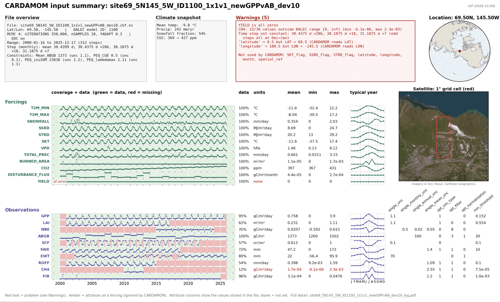
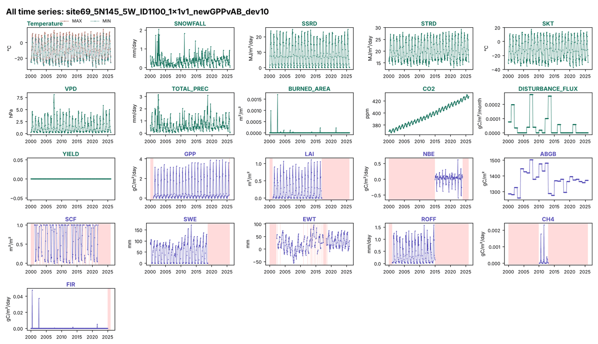
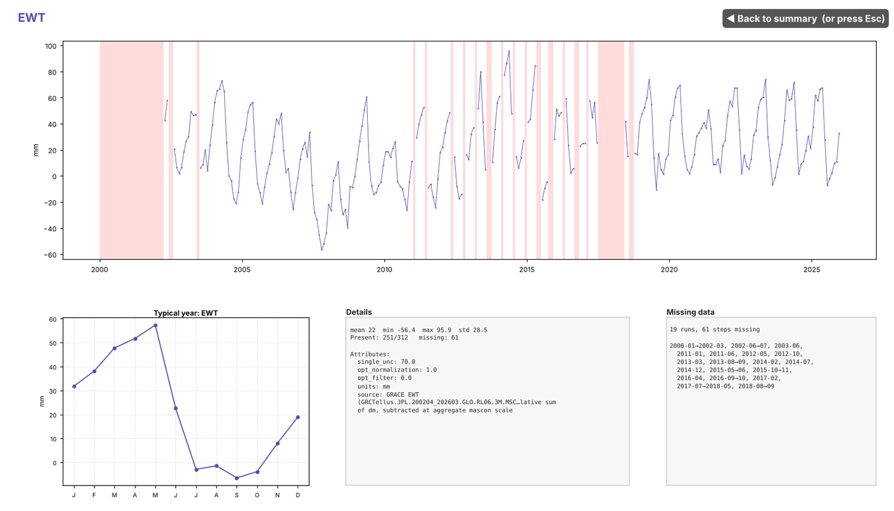
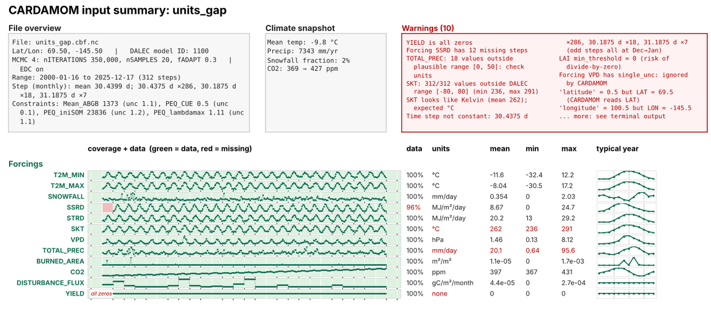

# CARDAMOM_CBF_SUMMARY.py

A one-screen visual sanity check of a CARDAMOM input file (`.cbf.nc`).

Run it before submitting jobs, or on a file someone says "doesn't work". In a few seconds it shows what the file contains, what is missing, broken or all zeros, where the data has gaps, and whether the values look like the right units.

It complements `CARDAMOM_CBF_NC_FILE_STRESS_TEST.py`:

| Script | Answers |
| --- | --- |
| `CARDAMOM_CBF_NC_FILE_STRESS_TEST.py` | Will this file run? |
| `CARDAMOM_CBF_SUMMARY.py` | What is actually in it, and does it look sensible? |



---

## Quick start

```bash
cd ~/CARDAMOM
git fetch && git checkout cbf_summary_script
python3 PYTHON/check_fun/CARDAMOM_CBF_SUMMARY.py path/to/file.cbf.nc
```

Two windows open (the summary on top, and all time series), and `<file>_log.pdf` is written to the folder you run from.

### Requirements

- Python 3 with `xarray`, `netCDF4`, `numpy`, `matplotlib`
- Optional: `cartopy` (`pip install cartopy`) for the globe and the satellite view
  - The first run downloads cartopy's coastline data once.
  - The satellite view (Esri World Imagery) needs internet; tiles are cached.
  - Without either, the maps fall back to a plain grid or a short note. Everything else works.
- `DALEC_MODEL_FIELD_REQUIREMENTS.txt` in the same folder as the script, for required fields and valid ranges.

---

## Reading the summary

**Header row**

- **File overview:** location, DALEC model ID, MCMC settings, date range, the time step, and single-value constraints (`PEQ_*`, `Mean_*`).
- **Climate snapshot:** mean temperature, annual precipitation, snowfall fraction, CO2 start and end.
- **Warnings:** everything the checks found, plus variables in the file that CARDAMOM doesn't use.
- **Globe:** where the site is.

**Lanes:** one per variable. Forcings are teal, observations purple.

| Column | What it shows |
| --- | --- |
| Lane | Green where data exists, red where it is missing, with the values drawn as dots on top |
| data | % of time steps with data (red for a forcing with any gap) |
| units | Units from the file, tidied (red if missing or flagged) |
| mean, min, max | Ballpark check (red if values break a range check) |
| typical year | Mean of each calendar month; faint guides at Apr/Jul/Oct |
| attribute columns | Observations only: uncertainty and option attributes, named exactly as in the file (`single_unc`, `single_annual_unc`, `opt_filter`, `min_threshold`, ...). Blank = not set. Amber on a forcing = set but ignored by CARDAMOM |

**Satellite view:** a close-up of the grid cell, outlined in red. The cell size is read from the file name (`1x1`, `0.5x0.5`, `4x5`); otherwise 1° is assumed and labelled "(assumed)".

### All time series (second window)

Every variable as its own small time-series plot on one page, with gaps shaded red. It's the quickest way to compare shapes and trends side by side, e.g. spot a step change, a spike, or a variable that stops early.



### Click-through

Click a lane, a variable name or its typical-year panel to see that variable full size in the same window. **◀ Back to summary** (or Esc) returns. Panels in the all-time-series window are clickable too, with **◀ Back** returning to the grid.



### Log PDF

`<file>_log.pdf` holds the summary, all time series, one full page per variable (time series, typical year, every attribute, missing runs), the single-value constraints, and the variables CARDAMOM doesn't use.

---

## What it checks

The checks target two kinds of problem: files that won't run, and files that run but give nonsense.

| Check | Example warning | Usually means |
| --- | --- | --- |
| Required field missing | `MISSING required field: CO2` | CARDAMOM will fail for this model ID |
| DALEC range | `SKT: 312/312 values outside DALEC range [-80, 80]` | Wrong units or bad data |
| Kelvin temperature | `SKT looks like Kelvin (mean 262)` | Temperature not converted to °C |
| Plausible range | `TOTAL_PREC: 18 values outside plausible range [0, 50]` | e.g. mm/month instead of mm/day |
| Units vs requirements file | `VPD units 'Pa', expected 'hPa'` | Unit mismatch (needs a units column, see below) |
| All zeros / all missing / constant | `YIELD is all zeros` | Empty or placeholder variable |
| Forcing gaps | `Forcing SSRD has 12 missing steps` | Forcings need every step |
| Observation without uncertainty | `Observation GPP has no uncertainty` | No `single_*_unc` attribute or `<VAR>unc` variable |
| Zero threshold | `LAI min_threshold = 0` | Risk of divide-by-zero in the likelihood |
| Attribute on a forcing | `Forcing VPD has single_unc: ignored by CARDAMOM` | Setting in the wrong place |
| Time axis | `Time step not constant`, `Time not sorted`, `duplicate timestamps` | Problems in how the file was built |
| Coordinates | `'latitude' = 0.5 but LAT = 69.5` | Leftover or mismatched coordinate variables |

Example: a copy of site69 with SKT in Kelvin, precipitation in mm/month, a missing year of SSRD, `min_threshold = 0` on LAI and an uncertainty on VPD. Every change is caught:



---

## Customising

Everything below is a constant near the top of the script.

| To change | Edit |
| --- | --- |
| How a unit string is displayed | `UNIT_LABELS` (exact matches). `Name [unit]` and `m-2`-style powers are handled automatically by `clean_units()` |
| Plausible-value ranges (unit checks) | `SANITY_RANGES` |
| Which variables are treated as temperatures | `TEMP_VARS` |
| Which variables count as observations, and their lane order | `OBS_ORDER` |
| Variables never drawn as lanes | `META_VARS` |
| Uncertainty / option attributes shown in the table | `UNC_ATTRS`, `OBS_OPT_ATTRS` |
| Window size and font size | `SCREEN_W`, `SCREEN_H`, `FS` |
| Table column positions | `COLS`, `ATTR_LEFT`, `ATTR_RIGHT` |

### Requirements file

`DALEC_MODEL_FIELD_REQUIREMENTS.txt` lines are:

```
FIELD:[min,max]:REQUIRED_BY:FINITE:RESPONDS[:UNITS]
```

The optional sixth column, units, turns on the units check, e.g. `VPD:[0,INF]:ALL:ALL:ALL:hPa`.

---

## Known limitations

- Past about 30 variables, the summary grows taller than a laptop screen.
- Flux tower files without a grid size in the name get a 1° "(assumed)" box on the satellite view.
- Offline, each run waits up to 6 s for the satellite server.
- Long daily records (20+ years) are untested and may be slow.
- The typical year of spiky variables (`BURNED_AREA`, `FIR`) is dominated by one or two events.
- After **Back**, the summary is a saved snapshot, so the zoom tool zooms the picture. This is deliberate: redrawing the whole summary took a few seconds every time, which made going back feel clunky.

## Feedback and bugs

Contact Jordan Roulstone (jordan.t.roulstone@jpl.nasa.gov). For a bug, send the command you ran, a screenshot and the terminal output, and the file if you can share it. Real files that caused problems before are the most useful test cases.
